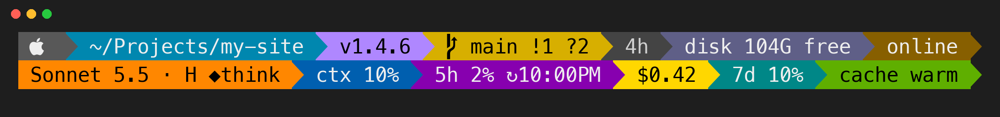

# refsH: Claude Code Status Enhancer

A powerline status line for [Claude Code](https://claude.com/claude-code) that matches the look of your **iTerm2 + Oh My Zsh + Powerlevel10k** prompt: project, git state, model and effort, context used, rate limits, cache state. It wraps to your terminal width, is easy to trim to a minimal version, and installs **without overwriting any of your files**.

Already running iTerm2, Oh My Zsh and the Powerlevel10k theme? Run one command and you are done. Your shell setup is not touched. Setting up a new Mac? An optional script installs that terminal stack for you too.

> Unofficial community project. Not affiliated with or endorsed by Anthropic.



*Rendered from the script's real output in a demo project (cost is the opt-in segment).*

## What you get

| Segment | Meaning |
|---|---|
| folder, `main !1 ?4` | Project folder and git branch with staged (`+`), changed (`!`) and untracked (`?`) counts, `⇡`/`⇣` ahead/behind, `no upstream` / `unpushed` warnings |
| `4h` | Age of the last commit (`s m h d w mo y`) |
| `v1.4.6` | Project version (from a `Version:` header or `package.json`) |
| `● local site up` | Opt-in (`SL_PROJECT_SEGMENTS=1`): for projects with `.wp-env.json` or `docker-compose.yml`; checks Docker |
| `disk … free`, `online` | Free disk space and network state (`online + VPN`, `offline`) |
| `Sonnet 5.5 · H ◆think` | Model, effort code (`L M H xH MX`), thinking and fast-mode flags |
| `ctx 10%` | Context window used |
| `5h 2% ↻9:40PM`, `7d 10%` | Rate-limit usage and reset time |
| `cache warm/cold` | Whether the prompt cache is warm |
| `$0.42` | Opt-in (`SL_SHOW_COST=1`): estimated session cost. It is a list-price estimate computed by Claude Code, mainly useful for **API users**. On a Pro/Max subscription it is not what you are billed; watch `5h`/`7d` instead. |

Every segment has its own colour. Optional segments can be hidden individually. Without a Nerd/Powerline font installed it automatically falls back to plain characters (force with `SL_GLYPHS=1` or `SL_GLYPHS=0`).

## Who it is for

- **iTerm2 + Oh My Zsh + Powerlevel10k users (the main audience):** run only `./install.sh`. The status line lives inside Claude Code and is independent of your prompt theme, so nothing in your shell changes.
- **Minimalists:** set `SL_PRESET=minimal` (see Configure) for just folder, git, model, effort and context.
- **Setting up a new Mac:** run `./setup-terminal.sh` first to get iTerm2, Oh My Zsh and Powerlevel10k, then `./install.sh`.

## Install (macOS)

```bash
git clone https://github.com/habibhqwork/refsH.git
cd refsH
./install.sh --dry-run     # preview, changes nothing
./install.sh               # install
./install.sh --uninstall   # remove only what the installer added
```

Needs `jq` (the installer can install it with Homebrew). Set your terminal font to **MesloLGS NF** for the arrows and icons, then restart Claude Code.

### Safe by design

- Our files live in their own folder, `~/.claude/status-enhancer/`.
- `~/.claude/settings.json`: only the `statusLine` key is added, and only if you don't already have one. A different existing `statusLine` is left alone. A timestamped backup is made first.
- Invalid JSON, non-regular files, missing `jq` or a non-macOS system stop the installer **before anything is changed**.
- `--dry-run` previews every step; `--uninstall` removes only what was added.

### Optional: the `refs` shortcut

The status line updates after each Claude message, not on a clock. `./install.sh --with-refs` adds one guarded `@import` line to `~/.claude/CLAUDE.md` so that sending just `refs` makes Claude answer `ok`, which re-runs the status line and refreshes every value.

## Configure

The installer creates `~/.claude/status-enhancer/config.sh` (and never overwrites it). Uncomment what you want:

```bash
SL_PRESET=minimal        # folder, git, model, effort, context only
SL_PROJECT_SEGMENTS=1    # opt in: local-site status (wp-env/docker-compose) and node/php versions
SL_GLYPHS=0              # plain text instead of powerline arrows
SL_SHOW_COST=1           # opt in: estimated session cost (off by default)
SL_SHOW_DISK=0           # hide any single segment: AGE VERSION NET DISK LIMITS CACHE
```

Project-specific segments (local site, node/php) are **off by default**.

## Optional: prettier terminal (iTerm2 + Oh My Zsh + Powerlevel10k)

```bash
./setup-terminal.sh --dry-run
./setup-terminal.sh
./setup-terminal.sh --no-brew   # skip Homebrew/iTerm2/font; only Oh My Zsh + Powerlevel10k
```

Installs only what is missing (Homebrew, iTerm2, MesloLGS NF, Oh My Zsh, Powerlevel10k). `.zshrc` is backed up and only the theme line and the `p10k` source line are touched. `~/.p10k.zsh` is installed only if you have none. It also makes sure `~/.local/bin` is on your PATH so the `claude` command keeps working.

## Troubleshooting

- **`claude: command not found` after changing shell config:** run `export PATH="$HOME/.local/bin:$PATH"` and add it to `~/.zshrc`.
- **Boxes instead of arrows:** set the terminal font to MesloLGS NF, or use `SL_GLYPHS=0`.
- **Values look stale:** the line refreshes after each assistant message; use the `refs` shortcut above.

## Testing status

Tested so far:
- `install.sh` against throwaway home folders: fresh, existing files, symlinks, invalid JSON, re-run, dry-run, uninstall.
- `setup-terminal.sh` with real downloads of Oh My Zsh and Powerlevel10k into a fresh home folder (theme, `p10k` and the `claude` PATH line all load).

**Not yet tested:** a full run on a completely clean Mac (real Homebrew and iTerm2 installs). An automated clean-macOS test is planned. Use `--dry-run` first, and please report issues.

## Requirements and limits

macOS and zsh. The status script uses macOS tools (`route`, `scutil`, `df`, `date -r`), so Linux needs small edits.

## License

MIT, see [LICENSE](LICENSE).
